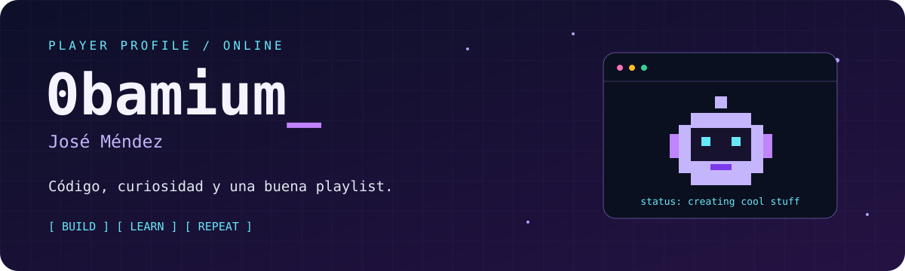

<p align="center">
  
</p>

<h1 align="center">¡Hola, geekers! 👾</h1>

<p align="center">
  Soy <strong>José Méndez</strong>, también conocido como <strong>0bamium</strong>.<br />
  Este es mi rincón para construir, experimentar y compartir lo que voy aprendiendo.
</p>

<p align="center">
  <a href="#-inventario-tecnológico">🧰 Inventario</a> ·
  <a href="#-misiones-destacadas">🚀 Proyectos</a> ·
  <a href="#-soundtrack-de-la-sesión">🎧 Soundtrack</a>
</p>

---

### 🕹️ Partida en curso

```text
PLAYER   José Méndez / 0bamium
QUEST    Convertir ideas en proyectos que funcionen
GEAR     .NET · C# · SQL Server
BONUS    Una buena playlist para acompañar el código
```

### 🧰 Inventario tecnológico

Herramientas presentes en mis proyectos:

<p>
  
  
  
  
  
</p>

### 🚀 Misiones destacadas

| Proyecto | ¿Qué hay dentro? | Tecnologías / conceptos |
| :--- | :--- | :--- |
| 🦷 [DentAssist](https://github.com/0bamium/DentAssist) | Gestión de pacientes, turnos y tratamientos para una clínica dental. | ASP.NET Core MVC · EF Core · SQL Server |
| 📚 [Letras Libres](https://github.com/0bamium/ProyectoLetrasLibres) | API para gestionar libros, usuarios y préstamos. | ASP.NET Core Web API · EF Core · Swagger |
| 🎟️ [Turnos Digitales](https://github.com/0bamium/Sistema_de_Gestion_de_Turnos_Digitales) | Modelado de un sistema de turnos y notificaciones. | UML · POO · Patrones de diseño |

### 🎧 Soundtrack de la sesión

<p align="center">
  <a href="https://open.spotify.com/user/jose.mendez.aqueveque">
    
  </a>
</p>

<p align="center">
  <a href="https://open.spotify.com/user/jose.mendez.aqueveque">Abrir mi Spotify ↗</a>
</p>

---

<p align="center">
  <strong>Gracias por pasar por mi pequeño universo digital ✨</strong><br />
  <sub>Siempre hay una próxima idea esperando su primer commit.</sub>
</p>
